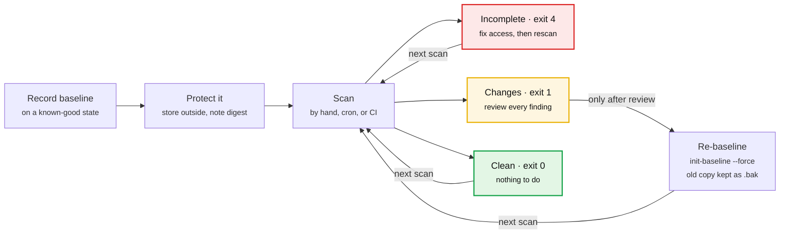

# FileSift User Guide

A complete guide to installing and using FileSift 1.0.0, the file integrity monitor that never reports a partial scan as clean.

## Contents

1. [Welcome](#welcome)
2. [Installation](#installation)
3. [Quick start: your first five minutes](#quick-start-your-first-five-minutes)
4. [Core concepts](#core-concepts)
5. [Command reference](#command-reference)
6. [Reading the results](#reading-the-results)
7. [Exit codes and automation](#exit-codes-and-automation)
8. [JSON reports](#json-reports)
9. [Excluding files](#excluding-files)
10. [Protecting your baseline](#protecting-your-baseline)
11. [Everyday workflows](#everyday-workflows)
12. [Troubleshooting and FAQ](#troubleshooting-and-faq)
13. [Limitations](#limitations)

---

## Welcome

FileSift tells you exactly which files in a folder were added, changed, deleted, re-typed, or re-permissioned since you last recorded it. It never calls a scan clean unless it could check everything.

It is a command-line tool for anyone who needs to notice unexpected changes: system administrators watching config folders, developers guarding a deployment directory, or students learning how file integrity monitoring (FIM) works.

**What FileSift does**

- Records a trusted snapshot of a folder, called a **baseline**: a SHA-256 fingerprint of every file, plus its permissions and every symlink's target.
- Later compares the folder against that baseline and reports every difference.
- Tells you plainly when it could not inspect something, instead of quietly treating it as fine.
- Produces a colorful terminal summary for people and a JSON report for scripts.

**What FileSift does not do**

- It never modifies, deletes, or restores your files. It only reads.
- It does not judge whether a change is malicious. That is your call.
- It does not watch folders in real time. You run it when you want an answer, by hand or on a schedule.
- It makes no network calls.

Every command in this guide was run against FileSift 1.0.0. Where Windows PowerShell and Linux/macOS differ, both versions are shown.

---

## Installation

You need Python 3.11 or newer. Installing FileSift takes one `pip install` inside a virtual environment.

**Windows (PowerShell)**, from the FileSift project folder:

```powershell
python -m venv .venv
.\.venv\Scripts\Activate.ps1
pip install .
```

If PowerShell refuses to run the activation script, run `Set-ExecutionPolicy -Scope CurrentUser RemoteSigned` once, then activate again.

**Linux and macOS**, from the FileSift project folder:

```bash
python3 -m venv .venv
. .venv/bin/activate
pip install .
```

**Check that it works:**

```text
$ filesift --version
filesift 1.0.0
```

`filesift --help` lists the three commands. `filesift scan --help` (or any other command with `--help`) lists that command's options.

Each new terminal window needs the virtual environment activated again before `filesift` is found. For the best-looking output on Windows, use Windows Terminal or the VS Code terminal. The older console window shows square box corners instead of rounded ones.

---

## Quick start: your first five minutes

This walkthrough takes you from an empty folder to a detected change: create sample files, record a baseline, scan, change something, and scan again.

1. **Create a sample folder** to monitor, plus a separate `state` folder for the baseline and a `reports` folder.

    Linux / macOS:

    ```bash
    mkdir -p demo-data/config demo-data/scripts state reports
    printf '{"debug": false}' > demo-data/config/settings.json
    printf 'print("backup")\n' > demo-data/scripts/backup.py
    printf 'print("legacy")\n' > demo-data/old_script.py
    ```

    Windows PowerShell:

    ```powershell
    mkdir demo-data\config, demo-data\scripts, state, reports
    Set-Content demo-data\config\settings.json '{"debug": false}' -NoNewline
    Set-Content demo-data\scripts\backup.py 'print("backup")'
    Set-Content demo-data\old_script.py 'print("legacy")'
    ```

2. **Record the baseline.** Keep it outside the folder you are monitoring.

    ```text
    filesift init-baseline demo-data --baseline state/baseline.json
    ```

    FileSift prints how many entries it recorded and the baseline's SHA-256 digest. Write that digest down somewhere safe (see [Protecting your baseline](#protecting-your-baseline)).

3. **Scan.** Nothing has changed yet, so the result panel is green and says `✓ CLEAN` (exit code 0).

    ```text
    filesift scan demo-data --baseline state/baseline.json
    ```

4. **Make some changes, then scan again with a report.**

    ```bash
    printf '{"debug": true}' > demo-data/config/settings.json
    printf 'print("new")\n' > demo-data/scripts/new_task.py
    rm demo-data/old_script.py
    chmod +x demo-data/scripts/backup.py
    filesift scan demo-data --baseline state/baseline.json --report reports/scan.json
    ```

    On Linux, this real run printed four findings and a yellow `● CHANGES DETECTED` panel (exit code 1):

    ```text
      Findings
      ╭───────────────────────┬──────────────────────┬───────────────╮
      │ Event                 │ Path                 │ Detail        │
      ├───────────────────────┼──────────────────────┼───────────────┤
      │  MODIFIED             │ config/settings.json │ 16 → 15 bytes │
      │  DELETED              │ old_script.py        │ 16 bytes      │
      │  PERMISSIONS_CHANGED  │ scripts/backup.py    │ 0644 → 0755   │
      │  ADDED                │ scripts/new_task.py  │ 13 bytes      │
      ╰───────────────────────┴──────────────────────┴───────────────╯
       +1 added   ~1 modified   -1 deleted   ±1 permissions
    ```

    Windows has no equivalent of `chmod +x`, so there you will see three findings instead of four.

The project also includes this whole sequence as [`examples/demo.sh`](../examples/demo.sh) for Linux and macOS.

---

## Core concepts

FileSift separates three answers: "something changed", "nothing changed", and "I could not check part of it". Only the second one earns a clean result.



Every path leads back to the next scan. Only the changes path updates the baseline, and only after you have reviewed every finding. An incomplete scan is fixed and rerun, never accepted.

**The baseline** is a JSON file describing the folder at one moment:

| Entry type | What is recorded |
| --- | --- |
| Regular file | SHA-256 digest, size, permission bits (for example `0644`), modification time |
| Symlink | The link's target text, exactly as stored. The link is never followed. |
| Special file (FIFO, socket, device) | Its kind. It is never opened. |

Directories are not stored on their own; they exist through the files inside them. The baseline also stores your exclusion patterns and a fingerprint of the folder's location.

**A scan** builds a fresh inventory the same way and compares it with the baseline, entry by entry.

**Coverage** is complete only when:
- every directory could be listed;
- every entry could be inspected;
- every file was hashed without changing mid-read;
- every filename was valid UTF-8.

If any of these fails, the scan is **incomplete**, even when no changes were found.

**Deleted means proven gone.** FileSift reports a file as deleted only when it successfully listed the parent folder and the name was missing. If a folder cannot be opened, everything under it is reported as `UNVERIFIED`, never as deleted.

The three possible outcomes of a scan:

| Status | What it means | Exit code |
| --- | --- | --- |
| `clean` | Everything was inspected and nothing changed | 0 |
| `changes_detected` | Everything was inspected and something changed | 1 |
| `incomplete` | Part of the folder could not be checked; any changes found are still listed | 4 |

---

## Command reference

FileSift has three commands:
- `init-baseline` records a snapshot;
- `scan` compares the folder with it;
- `verify-baseline` checks a baseline file.

`--baseline` is required on all three, so you always decide where the baseline lives.

### `init-baseline`: record a trusted snapshot

```text
filesift init-baseline TARGET --baseline PATH [options]
```

| Option | What it does |
| --- | --- |
| `TARGET` | The folder to record |
| `--baseline PATH` | Where to write the baseline file. The parent folder must already exist. |
| `--exclude PATTERN` | Skip matching paths. Repeat it for several patterns. Patterns are saved in the baseline (see [Excluding files](#excluding-files)). |
| `--force` | Replace an existing baseline. The old one is kept as `PATH.bak`. |
| `--allow-incomplete` | Write the baseline even if some paths could not be read; those paths are recorded as unverified. |

Without `--force`, FileSift refuses to overwrite an existing baseline (exit code 2) and leaves it untouched.

If some files or folders cannot be read, it lists them and exits with code 4 without writing anything. Pass `--allow-incomplete` to write the baseline anyway.

### `scan`: compare the folder with its baseline

```text
filesift scan TARGET --baseline PATH [options]
```

| Option | What it does |
| --- | --- |
| `--report PATH` | Also write the JSON report to a file. It must be outside `TARGET`, or under a path you excluded. |
| `--format text` | The default: the colored terminal summary |
| `--format json` | Print the JSON report, and nothing else, on standard output. Handy for `jq` and scripts. |
| `--exclude PATTERN` | Optional. If given, it must match the patterns stored in the baseline exactly; you cannot widen exclusions at scan time. |
| `--allow-root-mismatch` | Compare against a folder that was moved or renamed since the baseline was made |
| `--force-report` | Overwrite a file at `--report` that is not an earlier FileSift report |

A scan never creates, repairs, or changes the baseline.

### `verify-baseline`: check a baseline file

```text
filesift verify-baseline --baseline PATH
```

This checks the baseline's structure (and its signature, if you use a key). It then prints the baseline's SHA-256 digest, creation time, entry count, exclusions, and coverage.

Exit code 0 means the file is valid. Exit code 3 means it is damaged, has been tampered with, or failed authentication.

### Global options

| Option | What it does |
| --- | --- |
| `--version` | Print the version (`filesift 1.0.0`) |
| `--help` | Show help for FileSift or for one command |

---

## Reading the results

Read the **Result** panel at the bottom first: its color and first word tell you the outcome. Everything above it explains why.

A scan screen has five parts, top to bottom:

1. **Banner:** the FileSift wordmark in large block letters, with the version, the command, and which folder was compared. Terminals narrower than 72 columns show a compact one-line header instead.
2. **Info rows:** the baseline file and when it was made, whether it was authenticated, the coverage (`✓ complete` or `✗ PARTIAL`), and any exclusion patterns.
3. **Coverage gaps:** shown only on incomplete scans. There is one line per reason, such as a folder that could not be listed.
4. **Findings table:** one row per difference, with a colored event badge, the path, and a short detail. The chips underneath count findings by type, for example `+1 added   ~1 modified`.
5. **Result panel:** a heavy-bordered panel with a solid badge, green `✓ CLEAN`, yellow `● CHANGES DETECTED`, or red `✗ INCOMPLETE`, and the exit code in the corner.

An incomplete scan looks like this (real output from a Linux run where `private/` could not be opened):

```text
  Coverage gaps
    └ 1 directory could not be listed (private)
    └ 1 path unverified

  Findings
  ╭──────────────┬──────────────────────┬───────────────────────────────╮
  │ Event        │ Path                 │ Detail                        │
  ├──────────────┼──────────────────────┼───────────────────────────────┤
  │  MODIFIED    │ config/settings.json │ 16 → 15 bytes                 │
  │  UNVERIFIED  │ private/keys.conf    │ parent directory not listable │
  ╰──────────────┴──────────────────────┴───────────────────────────────╯
   ~1 modified   ?1 unverified

┏━ Result ━━━━━━━━━━━━━━━━━━━━━━━━━━━━━━━━━━━━━━━━━━━━━━━━━━━━━━━━━━━━━━━━━━━━━┓
┃                                                                              ┃
┃   ✗ INCOMPLETE                                                               ┃
┃                                                                              ┃
┃  1 change found, and coverage gaps mean more may be undetected.              ┃
┃  This is NOT a clean result.                                                 ┃
┃                                                                              ┃
┗━━━━━━━━━━━━━━━━━━━━━━━━━━━━━━━━━━━━━━━━━━━━━━━━━━━━━━━━━━━━━━━━━━━━━ exit 4 ━┛
```

### Change events

| Event | Meaning | Detail shown |
| --- | --- | --- |
| `ADDED` | A new file, symlink, or special file appeared | Size, or the symlink's target |
| `MODIFIED` | A file's content changed, or a symlink now points somewhere else | Old → new size (plus "mode changed" if permissions also changed), or old → new target |
| `DELETED` | An entry is gone, and its parent folder was listed successfully | Its recorded size |
| `TYPE_CHANGED` | The same path is now a different kind of thing, for example a file replaced by a symlink | Old → new type |
| `PERMISSIONS_CHANGED` | Same content, different permission bits, for example after `chmod +x` | Old → new mode, such as `0644 → 0755` |

### Coverage events

These mean FileSift could not fully check something. Any of them makes the whole scan incomplete.

| Event | Meaning | What to do |
| --- | --- | --- |
| `UNREADABLE` | The entry exists but could not be inspected or opened | Check the file's permissions, or run FileSift as a user who can read it |
| `UNSTABLE` | The file changed while it was being read, twice in a row | Re-run once whatever is writing to it has finished |
| `UNVERIFIED` | It sits inside a folder that could not be listed, or it was recorded as a gap in the baseline | Fix access to the folder. For baseline gaps, re-baseline once access is fixed. |

An incomplete scan always says **"This is NOT a clean result"**. Treat it as "unknown", never as "fine".

---

## Exit codes and automation

Every run ends with an exit code that scripts can trust. 0 is the only "all good", and a crash is never mistaken for a finding.

| Code | Meaning | Typical cause |
| --- | --- | --- |
| 0 | Complete scan, no changes; or a successful `init-baseline` / `verify-baseline` | Everything matched |
| 1 | Complete scan, changes detected | Files were added, modified, deleted, re-typed, or re-permissioned |
| 2 | Invalid arguments or configuration | Missing folder, report path inside the target, existing baseline without `--force`, exclusion mismatch, root mismatch, short key |
| 3 | Baseline problem | Missing, corrupt, invalid, or failed authentication |
| 4 | Incomplete scan or operational failure | Unreadable files or folders, target folder unreadable, write failure, any unexpected internal error |
| 130 | Interrupted | You pressed Ctrl+C |

**Precedence.** Codes 2 and 3 stop the run before scanning. After a scan, 4 beats 1, which beats 0. A scan that found changes and also had coverage gaps exits with 4, and the changes are still in the report.

A safe rule for automation is to treat any non-zero code as "needs attention".

**Checking the code**

```bash
filesift scan /srv/app --baseline /var/lib/filesift/app.json --report /var/log/filesift/app.json
echo $?
```

```powershell
filesift scan C:\app --baseline C:\filesift\app.json
$LASTEXITCODE
```

**Nightly scan with cron (Linux).** This entry writes a dated report every night at 02:00:

```text
0 2 * * * /opt/filesift/.venv/bin/filesift scan /srv/app --baseline /var/lib/filesift/app.json --report /var/log/filesift/app-$(date +\%F).json --format json > /dev/null || echo "FileSift needs attention on /srv/app" | mail -s "FileSift alert" admin@example.com
```

**In a CI pipeline**, fail the job on anything but 0:

```bash
filesift scan ./deploy --baseline ./ci/deploy-baseline.json --format json > filesift-report.json
```

Most CI systems fail a step automatically on a non-zero exit code. Keep `filesift-report.json` as a build artifact so reviewers can see what changed.

---

## JSON reports

`--report PATH` saves a report and `--format json` prints one. Both contain the same JSON. A script can act on `status` alone and look in `findings` for detail.

An excerpt from the real demo report ([`examples/sample-report.json`](../examples/sample-report.json)):

```json
{
  "envelope": {
    "schema": "7d7b-report",
    "schema_version": 1,
    "tool": "FileSift",
    "tool_version": "1.0.0",
    "run_id": "3a76f44d-cf65-4977-b420-4a93dd74c654",
    "started_at": "2026-10-25T15:51:38Z",
    "completed_at": "2026-10-25T15:51:38Z"
  },
  "status": "changes_detected",
  "result": "changes_detected",
  "findings": [
    {
      "event": "PERMISSIONS_CHANGED",
      "category": "integrity",
      "subject": "scripts/backup.py",
      "details": { "old_mode": "0644", "new_mode": "0755" }
    }
  ],
  "errors": []
}
```

| Field | What it tells you |
| --- | --- |
| `envelope` | Who produced the report and when: tool, version, a unique `run_id`, UTC start and end times |
| `status` | `clean`, `changes_detected`, or `incomplete`. This is the one field to branch on. |
| `result` | What was found in the part that was checked: `clean` or `changes_detected` |
| `target` | The folder's name (`label`) and location fingerprint |
| `baseline` | The baseline file's SHA-256, its creation time, whether it was authenticated, and whether the folder location matched (`root_match`) |
| `coverage` | Whether coverage was complete, how many entries were inventoried, how many were excluded by pattern or as tool files, the patterns applied, and folders that could not be listed |
| `summary` | A count per event type, plus the number of errors |
| `findings` | One object per finding: `event`, `category` (`integrity` or `coverage`), `subject` (the path), and `details` |
| `errors` | Problems found during the walk: `DIR_UNREADABLE` or `UNDECODABLE_NAME` |

`status` and `result` differ only on incomplete scans. `status: incomplete` with `result: changes_detected` means "changes were found, and there may be more you cannot see".

With `jq` installed, two handy one-liners:

```bash
filesift scan demo-data --baseline state/baseline.json --format json | jq -r .status
filesift scan demo-data --baseline state/baseline.json --format json | jq -r '.findings[] | "\(.event)\t\(.subject)"'
```

Some runs fail outright: exit code 2 or 3, an unreadable target folder, or Ctrl+C. In those cases no report file is written, and in JSON mode nothing is printed on standard output. A script can never mistake a half-finished run for a real result.

---

## Excluding files

You choose exclusions once, at `init-baseline`. They are saved inside the baseline and applied automatically on every scan. FileSift has no built-in exclusions, so nothing is skipped unless you say so.

```text
filesift init-baseline /srv/app --baseline /var/lib/filesift/app.json --exclude "*.log" --exclude "cache"
```

Each pattern is matched against an entry's path relative to the target folder. That path always uses forward slashes, and matching is case-sensitive:

| Pattern | Matches | Does not match |
| --- | --- | --- |
| `*.log` | `app.log`, `logs/2026/today.log` (`*` crosses folders) | `app.LOG` |
| `cache` | The top-level `cache` folder and everything inside it (the folder is never opened) | `src/cache` |
| `cache/*` | Everything inside the top-level `cache` folder | The `cache` folder entry itself |
| `*/cache` | A `cache` folder at any depth below the top level | `cache` at the top level |
| `config/secret.env` | That one file | Anything else |

Rules worth knowing:

- Patterns cannot be absolute (`/etc/...`), use `..`, or contain backslashes. FileSift rejects them with exit code 2.
- At scan time you can leave out `--exclude` entirely, and the stored patterns are used.
- If you do pass `--exclude` to `scan`, the set must match the stored one exactly (order and duplicates do not matter). This stops anyone from quietly widening a blind spot at scan time. To change exclusions, re-baseline with `--force`.
- Every report lists the patterns applied and how many entries they removed, because excluded paths are part of what was not checked.
- FileSift's own files (the baseline, its `.bak`, and the report) are skipped automatically when they are inside the target. They are matched only by their exact location. A file elsewhere that merely has the same name, such as a planted `baseline.json`, is still checked like any other.

---

## Protecting your baseline

A baseline is your definition of "normal", so anyone who can edit it can hide changes. Keep it out of reach of whatever you are monitoring.

**Storage checklist**

- [ ] Store baselines in a dedicated folder outside the target, for example `/var/lib/filesift/` or `~/.filesift/`.
- [ ] On Linux and macOS, lock that folder to `0700` and the baseline to `0400` or `0600`.
- [ ] Copy the SHA-256 digest that `init-baseline` prints to a place the monitored machine cannot write to, such as a password manager, a ticket, or another server.
- [ ] Before trusting a scan, run `verify-baseline` and check that the digest still matches.
- [ ] Only create a baseline from a state you know is good. A baseline made after a compromise treats the compromise as normal.

If you do put the baseline inside the target, FileSift warns you and skips it by its exact location. The risk above still applies.

### Optional: signing baselines with a key (HMAC)

Set the `FILESIFT_KEY` environment variable to a secret of at least 32 bytes. `init-baseline` then signs the baseline, and `scan` and `verify-baseline` refuse any baseline whose signature does not match.

```bash
export FILESIFT_KEY="$(python3 -c 'import secrets; print(secrets.token_hex(32))')"
```

```powershell
$env:FILESIFT_KEY = python -c "import secrets; print(secrets.token_hex(32))"
```

Store the generated key somewhere safe. Without it, a signed baseline cannot be used.

| Baseline is signed | Key is set | What happens |
| --- | --- | --- |
| Yes | Yes | The signature is checked. A mismatch (tampering or the wrong key) exits with 3. |
| Yes | No | Exits with 3: a signed baseline cannot be checked without its key |
| No | Yes | Exits with 3: the signature may have been stripped by an attacker |
| No | No | Runs normally; the report says `authenticated: false` |

A key shorter than 32 bytes makes every command exit with code 2. Where you can, keep the key off the monitored machine, for example by injecting it as a CI secret. Environment variables are visible to other programs run by the same user.

---

## Everyday workflows

Most day-to-day use is a loop: scan, review what changed, and re-baseline only once you are satisfied that every change is legitimate.

### Accepting legitimate changes (re-baselining)

1. Run a scan and read every finding.
2. Confirm each change is expected, for example a deployment you made or a config edit you approved.
3. Record the new state with `--force`:

    ```text
    filesift init-baseline /srv/app --baseline /var/lib/filesift/app.json --force
    ```

4. Record the new digest it prints. The previous baseline is kept as `app.json.bak` in case you need to compare or roll back.

Re-baselining accepts everything currently on disk, including a malicious change hidden among legitimate ones. Never skip step 1.

### Monitoring several folders

Give each folder its own baseline file, for example `/var/lib/filesift/app.json` and `/var/lib/filesift/nginx.json`, and scan each one separately. A baseline is tied to one folder.

### The folder was moved or renamed

A baseline remembers a fingerprint of the folder's location, so scanning a different path exits with code 2.

If the folder really was moved, add `--allow-root-mismatch`. The scan then runs, and the report records `root_match: false`. To make the new location permanent, re-baseline there.

### Keeping reports

- `--report` refuses to overwrite a file that is not an earlier FileSift report, so a typo cannot destroy an unrelated file. Add `--force-report` if you really mean it.
- An earlier FileSift report at the same path is replaced safely, in one step.
- Reports must be stored outside the monitored folder, unless they are under a path you excluded.
- Use dated names, such as `app-2026-10-25.json`, to keep a history.

### Some paths cannot be read when you create the baseline

`init-baseline` stops with exit code 4 and lists the unreadable paths. You have two options:

- **Fix access and run it again.** This is the better option.
- **Pass `--allow-incomplete`.** The unreadable paths are recorded as gaps, and every later scan reports them as `UNVERIFIED`. Scans stay incomplete until you re-baseline with full access.

---

## Troubleshooting and FAQ

Every error is printed on the error stream and starts with `✗ error:`, followed by a plain-language reason and usually the fix. Look up the start of the message in this table:

| Message starts with | Exit | What to do |
| --- | --- | --- |
| `baseline already exists` | 2 | Add `--force` to replace it (the old one is kept as `.bak`), or pick a new path |
| `baseline not found` | 3 | Check the path, or create a baseline with `init-baseline` |
| `target does not exist` / `target is not a directory` | 2 | Check the folder path you gave |
| `output directory does not exist` | 2 | Create the folder for the baseline or report first |
| `report path is inside TARGET` | 2 | Write the report outside the monitored folder |
| `report path collides with the baseline` | 2 | Use a different file name for the report |
| `refusing to overwrite … not a FileSift report` | 2 | Choose another path, or add `--force-report` |
| `refusing to write … it is a symlink` (or a directory) | 2 | Remove or rename what is at that path; FileSift never writes through a link |
| `--exclude […] does not match the exclusions stored` | 2 | Leave `--exclude` out of the scan, or re-baseline with the new patterns |
| `baseline was recorded for a different directory` | 2 | Scan the original folder, or add `--allow-root-mismatch` if it moved |
| `FILESIFT_KEY must be at least 32 bytes` | 2 | Use a longer key, or unset the variable |
| `baseline is not valid UTF-8 JSON` / `baseline failed validation` | 3 | The file is damaged or was edited. Restore it from `.bak` or a backup, or re-baseline from a known-good state. |
| `baseline has no MAC but FILESIFT_KEY is set` | 3 | The signature may have been stripped. Investigate, or unset the key if this baseline was never signed. |
| `baseline is authenticated but FILESIFT_KEY is not set` | 3 | Set the key that signed it |
| `baseline MAC does not match` | 3 | The baseline was tampered with or the key is wrong. Investigate before trusting any scan. |
| `cannot list target directory` | 4 | The monitored folder itself is unreadable; fix its permissions |
| `internal error:` | 4 | An unexpected bug. Re-run, and report it with the full message. |

**`filesift` is not recognized as a command.** The virtual environment is not active in this terminal. Activate it again (see [Installation](#installation)), or run `.venv/bin/filesift` directly (`.venv\Scripts\filesift.exe` on Windows).

**I changed permissions on Windows and nothing was reported.** Windows exposes little more than the read-only flag, so permission tracking is only meaningful on Linux and macOS.

**An empty folder I added or removed was not reported.** Folders are not tracked on their own, only the entries inside them.

**A file shows as `UNSTABLE`.** Something was writing to it during both read attempts, such as a live log file. Re-run later, or exclude files that are always changing.

**The output shows square corners or odd symbols.** Use Windows Terminal, the VS Code terminal, or any modern Linux or macOS terminal. Set `NO_COLOR=1` to turn colors off entirely, for example when saving output to a file.

---

## Limitations

A clean result means no changes were found in the part FileSift fully inspected. It does not mean the system is secure.

- **Matching is not trust.** A matching digest proves a file's bytes are unchanged since the baseline, not that the file is safe.
- **The baseline is only as good as its moment.** A baseline recorded after a compromise treats the compromise as normal.
- **An unprotected baseline can be rewritten.** Someone who can change both the files and an unsigned baseline can hide changes; see [Protecting your baseline](#protecting-your-baseline).
- **A scan is not an instant snapshot.** Files that change while being read are usually caught as `UNSTABLE`, but not always.
- **Not tracked:**
  - empty folders being added or removed;
  - file ownership (user and group);
  - extended attributes and ACLs;
  - Windows alternate data streams;
  - timestamps, which are stored for reference only and never used as evidence because they are easy to fake.
- **Windows differences:**
  - Permission tracking is minimal.
  - Junctions are recorded as symlinks.
  - If a file is swapped for a symlink between being listed and being read, FileSift can follow that link. The window for this is very short.
- **Filenames that are not valid UTF-8** (possible on Linux) cannot be recorded. They are reported as errors and keep the scan incomplete.
- **Baselines are not portable** between operating systems, because letter case, Unicode forms, and permissions differ. Create a baseline on the system you will scan.
- **No judgement.** FileSift reports changes. Deciding whether a change is malicious is up to you.
